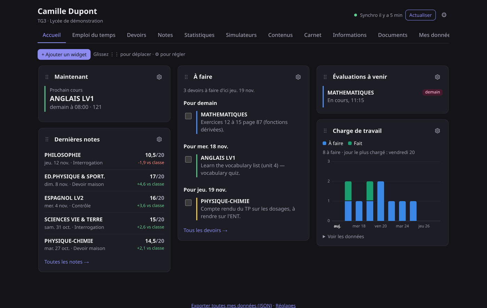

<h1 align="center">repronote</h1>

<p align="center"><b>Pronote, en mieux.</b> Plus clair, plus rapide, et ça marche même sans internet.</p>

<p align="center">
  <a href="https://github.com/AnCarsenat/repronote/releases/latest"><b>⬇ Télécharger</b></a> ·
  <a href="#installer-en-2-minutes">Installer</a> ·
  <a href="#guide-détaillé">Guide détaillé</a>
</p>

<p align="center"></p>

<p align="center"><sub>Toutes les captures utilisent des données inventées.</sub></p>

## Ce que ça fait

- **Tout sur un seul écran d'accueil** : prochain cours, devoirs, dernières notes, évaluations… Vous choisissez les widgets et leur place.
- **Emploi du temps lisible**, avec les heures de trou, les cours annulés et les évaluations. Touchez un cours pour voir la salle et le professeur.
- **Devoirs à cocher**, dans une liste qui défile jusqu'à la fin de l'année, et un graphique de la charge de travail.
- **Vraie moyenne générale** : coefficients des matières, bonus, préréglages bac et brevet, simulateurs d'examen.
- **Statistiques** : évolution de la moyenne, matière par matière.
- **Tout le reste de Pronote** : informations (à marquer comme lues), carnet (absences, retards, punitions), contenus de cours, documents et bulletins, annuaire des professeurs.
- **Hors ligne** : tout est gardé sur votre appareil, vous pouvez consulter sans réseau.
- **Thème sombre**, onglets à masquer, taille du texte… dans les Réglages.

| | |
|---|---|
|  |  |
| **Emploi du temps** avec les trous | **Notes** et moyenne calculée |
|  |  |
| **Statistiques** | **Thème sombre** |

<p align="center"></p>

## Installer en 2 minutes

Allez sur la **[page de la dernière version](https://github.com/AnCarsenat/repronote/releases/latest)** et prenez le fichier qui correspond à votre appareil :

| Vous avez… | Fichier à prendre | Puis |
|---|---|---|
| 📱 **Android** | `…-android-arm64-v8a.apk` | Ouvrez-le. Si le téléphone le demande, autorisez « installer des applications inconnues » pour votre navigateur. |
| 🪟 **Windows** | `…-win-x64.exe` | Lancez-le. Si Windows affiche « Windows a protégé votre ordinateur », cliquez **Informations complémentaires** puis **Exécuter quand même** (l'application n'est pas encore signée). |
| 🐧 **Linux** (Ubuntu, Mint, Debian…) | `…-linux-amd64.deb` | Double-cliquez dessus pour l'installer. |
| 🐧 **Linux** (autre) | `…-linux-x86_64.AppImage` | Clic droit → Propriétés → « Autoriser l'exécution », puis double-clic. |
| 🐧 **Linux**, en une commande | — | Dans un terminal : `curl -fsSL https://github.com/AnCarsenat/repronote/releases/latest/download/install-linux.sh \| bash` |

Ensuite :

1. Ouvrez Pronote comme d'habitude dans votre navigateur (en passant par l'ENT si besoin) et **copiez l'adresse** de la page. Elle ressemble à `https://0000000a.index-education.net/pronote/…`.
2. Ouvrez repronote et **collez cette adresse**.
3. Une fenêtre de connexion s'ouvre : **connectez-vous comme d'habitude** (ENT ou Pronote).

C'est tout. Les fois suivantes, repronote se reconnecte tout seul tant que l'ENT vous garde connecté.

> repronote ne garde ni votre mot de passe ni rien d'autre ailleurs que sur votre appareil. C'est un projet indépendant, non affilié à Index Éducation.

**Un problème ?** [Ouvrez un ticket](https://github.com/AnCarsenat/repronote/issues) en décrivant ce que vous avez fait et ce qui s'est affiché.

*English: an alternative, offline-first Pronote frontend (desktop, Android, or a local server with an HTTP API and MCP). Login goes through your school's ENT in a real browser; the live session is handed to [pawnote](https://github.com/BlocksHub/Pawnote-LTS). UI in French.*

---

# Guide détaillé

## Tous les fichiers

| Fichier | Pour |
|---|---|
| `repronote-…-win-x64.exe` | Windows (installateur) |
| `install-linux.sh` | Linux, toutes distributions : installe la dernière AppImage dans `/usr/local/bin` avec une entrée dans le menu des applications |
| `repronote-…-linux-x86_64.AppImage` | Linux, toutes distributions (pas besoin de `fuse2`/`libfuse2`) |
| `repronote-…-linux-amd64.deb` | Debian, Ubuntu, Mint… |
| `repronote-…-linux-x64.tar.gz` | Linux sans AppImage : extraire puis lancer `./repronote` |
| `repronote-…-android-arm64-v8a.apk` | Android 7+ (presque tous les téléphones) |
| `repronote-…-android-armeabi-v7a.apk` | Anciens téléphones Android 32 bits |
| `repronote-…-android-x86_64.apk` | Émulateurs Android, Chromebooks x86 |
| `repronote-server-….zip` | Le serveur seul (Node ≥ 24 + Chromium), pour un serveur ou un Raspberry Pi |

## Depuis les sources

Prérequis : **Node.js ≥ 24** et **Chromium** (ou Chrome).

```sh
git clone https://github.com/AnCarsenat/repronote.git
cd repronote
npm install
```

Si Chromium n'est pas dans `/usr/bin/chromium`, indiquez son chemin : `export CHROMIUM_PATH=/chemin/vers/chromium`.

## Utilisation

```sh
# 1. Première connexion : une fenêtre s'ouvre, connectez-vous via l'ENT.
npm run login -- https://XXXXXXXX.index-education.net/pronote/

# 2. L'interface : http://localhost:4173
npm run serve

# Ou en ligne de commande :
npm run homework

# L'application de bureau (Electron), depuis les sources :
npm run desktop
```

Les connexions suivantes se font **en arrière-plan** tant que la session ENT est valide (cookies gardés dans un profil Chromium dédié). Quand l'ENT redemande le mot de passe, la fenêtre se rouvre (le mot de passe enregistré par Chromium est validé automatiquement).

## Comment ça marche

Pronote 2026 a cassé la connexion par jeton des bibliothèques existantes. repronote se connecte donc **dans un vrai navigateur** (Playwright + Chromium), laisse l'ENT/CAS faire son travail, puis **reprend la session ouverte** dans la page (identifiant, clés AES, compteur de requêtes) et la confie à pawnote. La page est figée avant la reprise pour qu'elle n'envoie plus rien.

Quelques données que pawnote ne sait pas (ou plus) lire sont récupérées directement :

| Donnée | Méthode |
|---|---|
| Documents, bulletins | requête Pronote `Casier` (onglet 103), PDF via `GenerationPDF` |
| Informations | liste via `PageActualites` ; textes récupérés par la page Pronote elle-même au moment de la connexion ; « lu » via `SaisieActualites` (`genreSaisie: 0`) |
| Annuaire | requête `ListeRessourcesPourCommunication` ; e-mails via l'autocomplétion du webmail ENT (`psn.monlycee.net/address-book/contacts?filter=`), une recherche par personne de l'annuaire |
| Devoirs | archive locale de tous les devoirs de l'année (les identifiants Pronote changent à chaque session : clé stable matière + date + texte) |
| Fichiers | téléchargés via le serveur local et gardés dans `data/files` (les liens Pronote expirent avec la session) |

## Données et vie privée

Tout reste dans le dossier `data/` (ignoré par git) : base SQLite, profil Chromium (cookies ENT), fichiers. Le serveur écoute **uniquement sur localhost**. Pour l'exposer sur votre réseau : `HOST=0.0.0.0 npm run serve` — attention, toute personne du réseau pourrait alors lire vos données et agir en votre nom.

## API

Le serveur local expose une API JSON. `GET /api` en donne la liste.

| Méthode | Chemin | Rôle |
|---|---|---|
| GET | `/api/state` | Tout : état de synchro, mise en page, réglages, et chaque jeu de données (`homework`, `timetable`, `grades`, `news`, `notebook`, `documents`, `resources`, `account`…) avec sa date de mise à jour |
| POST | `/api/sync` | Synchroniser maintenant (sans fenêtre) |
| POST | `/api/login` | Ouvrir la fenêtre de connexion puis synchroniser |
| POST | `/api/homework/:id/done` | Cocher / décocher un devoir — corps `{ "done": true }` (mis en file si hors ligne) |
| PUT | `/api/layout` | Mise en page de l'accueil — `{ "widgets": [{ "id", "type", "col", "size", "settings" }] }` |
| PUT | `/api/subject-settings` | Coefficients des matières — `{ "MATIÈRE": { "coef": 2, "mode": "normal" \| "bonus" \| "excluded" } }` |
| GET | `/api/file?id=&n=` | Pièce jointe (mise en cache) |
| GET | `/api/doc/casier?id=&n=` | Document du casier |
| GET | `/api/doc/bulletin?ident=&n=&period=&year=` | Bulletin en PDF |
| GET | `/api/homework/range?from=AAAA-MM-JJ&to=AAAA-MM-JJ` | Devoirs sur une période (120 jours max), en direct ou depuis l'archive locale |
| POST | `/api/news/read` | Marquer une information comme lue / non lue dans Pronote — `{ "key": "...", "read": true }` |
| GET | `/api/contacts` | Annuaire : professeurs (matières) et personnels (fonction) joignables par la messagerie. `/api/contacts.csv` pour un tableur |
| POST | `/api/contacts/emails` | Cherche l'adresse e-mail de chacun de ces professeurs/personnels avec l'autocomplétion du webmail de l'ENT (une fenêtre s'ouvre pour s'y connecter ; une recherche par personne, rien d'autre n'est lu) |
| GET | `/api/export` | Toutes les données en un fichier JSON |

Exemple :

```sh
curl -s localhost:4173/api/state | jq '.data.homework.data[] | {matiere: .subject.name, pour: .deadline, fait: .done}'
```

Les données suivent les types de [pawnote](https://github.com/BlocksHub/Pawnote-LTS) (dates en ISO).

## Assistant IA (MCP)

repronote expose ses données à un assistant IA via le [Model Context Protocol](https://modelcontextprotocol.io) : devoirs, emploi du temps, notes, informations, carnet, documents, et cocher un devoir ou marquer une information comme lue.

- **Clients HTTP** (Claude Code…) : `claude mcp add --transport http repronote http://127.0.0.1:4173/mcp`
- **Clients qui lancent une commande** (Claude Desktop…) : `npm run mcp` (ou `node dist/mcp.mjs` dans le paquet serveur), avec repronote lancé à côté. Exemple de configuration :
  ```json
  { "mcpServers": { "repronote": { "command": "node", "args": ["/chemin/vers/repronote/dist/mcp.mjs"] } } }
  ```

Outils : `get_today`, `get_timetable`, `get_homework`, `set_homework_done`, `get_grades`, `get_news`, `mark_news_read`, `get_notebook`, `get_lesson_contents`, `list_documents`, `sync_now`.

## Écrire un widget

Un widget est un module dans `web/widgets/`, à ajouter dans `web/widgets/index.js` :

```js
import { h, homeworkList } from "../lib.js";

export default {
  type: "compteur",
  title: "Compteur de devoirs",
  description: "Combien de devoirs il reste.",
  needs: ["homework"],                 // données lues
  defaults: { jours: 7 },
  settings: [{ key: "jours", label: "Nombre de jours", type: "number", min: 1, max: 30 }],
  render(data, settings) {             // ne lit que la copie locale : marche hors ligne
    const limite = Date.now() + settings.jours * 864e5;
    const n = homeworkList(data).filter((a) => !a.done && a.deadline < limite).length;
    return h("p", { class: "big" }, String(n));
  },
};
```

Il apparaît dans « + Ajouter un widget », avec ses réglages dans la roue ⚙. Les pièces communes sont dans `web/components.js` (devoir à cocher, cours, fenêtre) et `web/charts.js`.

## Structure

```
src/
  core/        connexion (navigateur, reprise de session), requêtes Pronote brutes
  electron/    application de bureau
  mcp/         serveur MCP (outils pour assistants IA)
  store/       base SQLite, synchronisation, cache de fichiers
  server.ts    serveur HTTP + API
  cli/         npm run login / homework
web/
  views/       pages (accueil, emploi du temps, devoirs, notes…)
  widgets/     widgets de l'accueil
```

`npm run typecheck` vérifie les types (Node exécute le TypeScript directement).

### Construire

| Commande | Produit |
|---|---|
| `npm run build` | `dist/server.mjs`, `dist/electron-main.mjs`, `dist/mcp.mjs`, `dist/android.mjs` (esbuild) |
| `npm run dist:linux` | AppImage + .deb + .tar.gz dans `release/` |
| `npm run dist:win` | installateur Windows (sur Windows) |
| `npm run dist:server` | `release/repronote-server/` |
| `node scripts/demo-data.mjs <dossier>` | Données inventées pour essayer ou faire des captures : `REPRONOTE_DATA_DIR=<dossier> npm run serve` |
| `node scripts/screenshots.mjs <url> docs/screenshots` | Les captures de ce README |
| `npm run dist:android` | APK Android (un par architecture) dans `android/app/build/outputs/apk/release/` — demande le SDK Android (avec NDK et CMake) et Java 17+ |

Le workflow GitHub `.github/workflows/build.yml` construit tout à chaque push ; un tag `v1.2.3` publie une Release avec les fichiers.

L'application de bureau lance le serveur dans Electron et utilise ses propres fenêtres pour la connexion (pas de Playwright) ; ses données sont dans le profil utilisateur (`~/.config/repronote/data`, `%APPDATA%\repronote\data`).

L'application Android embarque Node (nodejs-mobile 18, téléchargé au premier build) qui lance le même serveur (`dist/android.mjs`) ; l'interface est une WebView sur ce serveur. La connexion ENT se fait dans une seconde WebView, pilotée par le protocole DevTools comme les fenêtres Electron. Les autres applications du téléphone pouvant joindre `127.0.0.1`, le serveur exige un jeton secret (cookie) que seule l'application connaît.

## Licence

GPL-3.0-or-later (comme pawnote, dont deux décodeurs sont adaptés).
