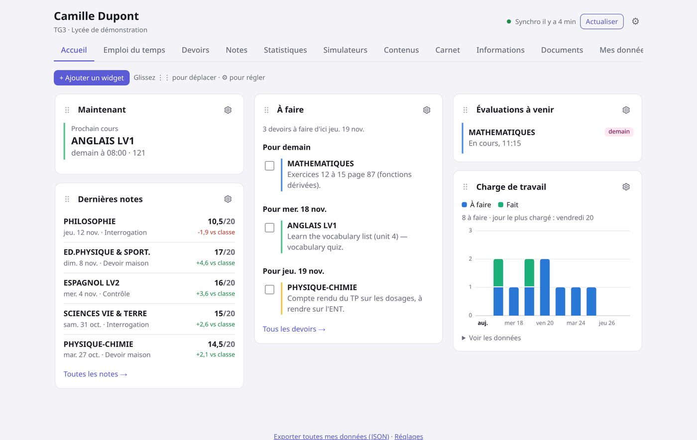
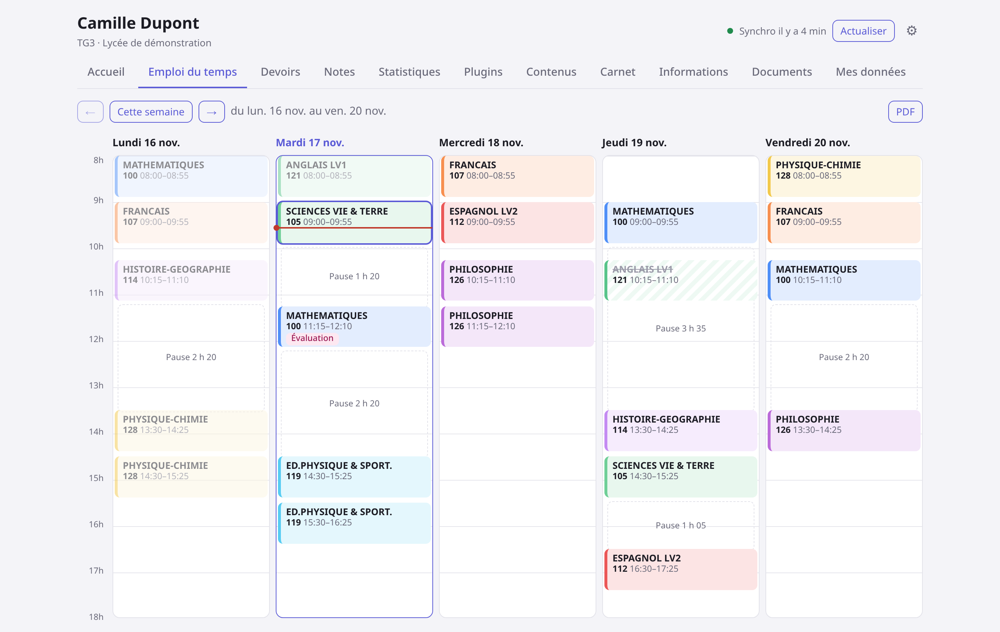
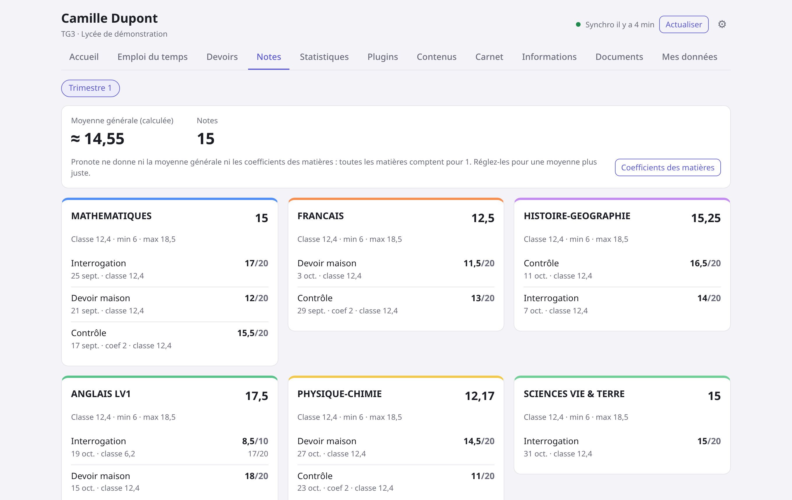
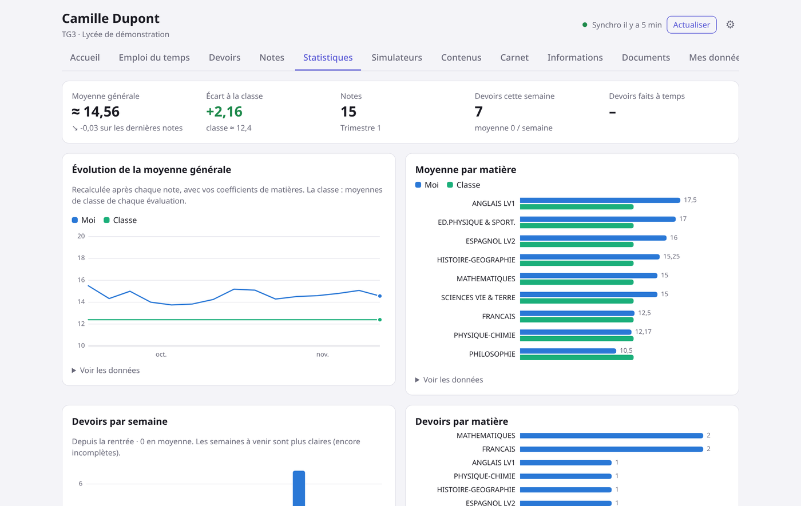
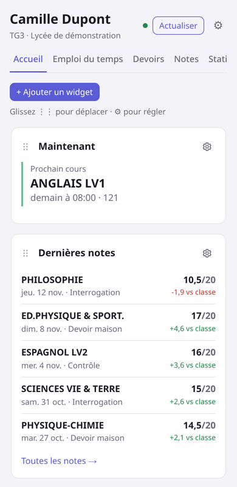

<h1 align="center">repronote</h1>

<p align="center"><b>Pronote, en mieux.</b> Plus clair, plus rapide, et ça marche même sans internet.</p>

<p align="center">
  <a href="https://ancarsenat.github.io/repronote/"><b>⬇ Télécharger</b></a> ·
  <a href="#installer-en-2-minutes">Installer</a> ·
  <a href="#guide-détaillé">Guide détaillé</a> ·
  <a href="docs/README.md">Documentation</a>
</p>

<p align="center"></p>

<p align="center"><sub>Toutes les captures utilisent des données inventées.</sub></p>

## Ce que ça fait

- **Tout sur un seul écran d'accueil** : prochain cours, devoirs, dernières notes, évaluations… Vous choisissez les widgets et leur place.
- **Emploi du temps lisible**, avec les heures de trou, les cours annulés et les évaluations. Touchez un cours pour voir la salle et le professeur.
- **Devoirs à cocher**, dans une liste qui défile jusqu'à la fin de l'année, et un graphique de la charge de travail.
- **Vraie moyenne générale** : coefficients des matières, bonus, préréglages bac et brevet.
- **Plugins** : les **calculateurs** (bac, brevet, « où gagner des points »), l'**emploi du temps partagé** (échangez vos emplois du temps avec vos amis : qui est en cours, quand vous êtes libres ensemble, export PDF / HTML / agenda), et des plugins et widgets de la communauté installés depuis GitHub, chacun dans un bac à sable.
- **Widget Note** sur l'accueil, en Markdown simple mis en forme pendant la frappe.
- **Statistiques** : évolution de la moyenne, matière par matière.
- **Exports** : emploi du temps en PDF, tous vos documents (bulletins, casier, pièces jointes) en un ZIP, toutes vos données en JSON.
- **Notifications** : nouvelle note, nouveau devoir, information, cours annulé — sur l'ordinateur, le téléphone, ou dans un salon **Discord** (webhooks).
- **Tout le reste de Pronote** : informations (à marquer comme lues), carnet (absences, retards, punitions), contenus de cours, documents et bulletins, annuaire des professeurs.
- **Hors ligne** : tout est gardé sur votre appareil, vous pouvez consulter sans réseau.
- **À votre goût** : thème sombre, couleur, police, taille du texte, densité (jusqu'à ultra-compacte), **mode daltonien**, onglets à masquer.
- **Mises à jour** : repronote vous prévient quand une nouvelle version sort (canal stable ou dev), sur toutes les plateformes.
- **Inviter des amis** : un message tout prêt avec le lien de téléchargement (et votre code d'emploi du temps).

| | |
|---|---|
|  |  |
| **Emploi du temps** avec les trous | **Notes** et moyenne calculée |
|  |  |
| **Statistiques** | **Thème sombre** |

<p align="center"></p>

## Installer en 2 minutes

Le plus simple : la **[page de téléchargement](https://ancarsenat.github.io/repronote/)** propose directement le bon fichier pour votre appareil. Sinon, sur la **[page de la dernière version](https://github.com/AnCarsenat/repronote/releases/latest)**, prenez le fichier qui correspond à votre appareil :

| Vous avez… | Fichier à prendre | Puis |
|---|---|---|
| 📱 **Android** | `…-android-arm64-v8a.apk` | Ouvrez-le. Si le téléphone le demande, autorisez « installer des applications inconnues » pour votre navigateur. |
| 🪟 **Windows** | `…-win-x64.exe` | Lancez-le. Si Windows affiche « Windows a protégé votre ordinateur », cliquez **Informations complémentaires** puis **Exécuter quand même** (l'application n'est pas encore signée). |
| 🍎 **Mac** | `…-mac-arm64.dmg` (Mac Intel d'avant 2020 : `…-mac-x64.dmg`) | Ouvrez-le et glissez repronote dans **Applications**. Au premier lancement, macOS refuse de l'ouvrir (l'application n'est pas signée par Apple) : **Réglages Système → Confidentialité et sécurité → Ouvrir quand même**. Voir [macOS](#macos) si besoin. |
| 🐧 **Linux** (Ubuntu, Mint, Debian…) | `…-linux-amd64.deb` | Double-cliquez dessus pour l'installer. |
| 🐧 **Linux** (autre) | `…-linux-x86_64.AppImage` | Clic droit → Propriétés → « Autoriser l'exécution », puis double-clic. |
| 🐧 **Linux**, en une commande | — | Dans un terminal : `curl -fsSL https://github.com/AnCarsenat/repronote/releases/latest/download/install-linux.sh \| bash`. Il vous demande : l'application, ou le serveur (à utiliser dans votre navigateur). |

Ensuite :

1. Ouvrez Pronote comme d'habitude dans votre navigateur (en passant par l'ENT si besoin) et **copiez l'adresse** de la page. Elle ressemble à `https://0000000a.index-education.net/pronote/…`.
2. Ouvrez repronote et **collez cette adresse**.
3. Une fenêtre de connexion s'ouvre : **connectez-vous comme d'habitude** (ENT ou Pronote).

C'est tout. Les fois suivantes, repronote se reconnecte tout seul tant que l'ENT vous garde connecté.

> repronote ne garde ni votre mot de passe ni rien d'autre ailleurs que sur votre appareil. C'est un projet indépendant, non affilié à Index Éducation.

**Envie d'essayer les nouveautés avant tout le monde ?** La [version de développement](https://ancarsenat.github.io/repronote/dev/) est reconstruite à chaque modification (elle peut être instable).

**Un problème ?** [Ouvrez un ticket](https://github.com/AnCarsenat/repronote/issues) en décrivant ce que vous avez fait et ce qui s'est affiché.

*English: an alternative, offline-first Pronote frontend (desktop, Android, or a local server with an HTTP API and MCP). Login goes through your school's ENT in a real browser; the live session is handed to [pawnote](https://github.com/BlocksHub/Pawnote-LTS). UI in French.*

---

# Guide détaillé

## Tous les fichiers

| Fichier | Pour |
|---|---|
| `repronote-…-win-x64.exe` | Windows (installateur) |
| `repronote-…-mac-arm64.dmg` | Mac Apple Silicon (M1 et plus récents) |
| `repronote-…-mac-x64.dmg` | Mac Intel |
| `install-linux.sh` | Linux : installe la dernière version avec une entrée dans le menu des applications — l'application (`--app`) ou le serveur (`--server`, voir plus bas) |
| `repronote-…-linux-x86_64.AppImage` | Linux, toutes distributions (pas besoin de `fuse2`/`libfuse2`) |
| `repronote-…-linux-amd64.deb` | Debian, Ubuntu, Mint… |
| `repronote-…-linux-x64.tar.gz` | Linux sans AppImage : extraire puis lancer `./repronote` |
| `repronote-…-android-arm64-v8a.apk` | Android 7+ (presque tous les téléphones) |
| `repronote-…-android-armeabi-v7a.apk` | Anciens téléphones Android 32 bits |
| `repronote-…-android-x86_64.apk` | Émulateurs Android, Chromebooks x86 |
| `repronote-server-….zip` | Le serveur seul (Node ≥ 24 + Chromium), pour un serveur ou un Raspberry Pi |

## macOS

L'application Mac n'est pas signée par Apple (il faudrait un compte développeur payant) ; elle a une signature « ad hoc », ce qui suffit pour qu'elle tourne. Au premier lancement :

1. Double-cliquez sur repronote dans Applications : macOS dit qu'il ne peut pas vérifier l'application. Cliquez **OK** (pas « Placer dans la corbeille »).
2. **Réglages Système → Confidentialité et sécurité**, en bas : **Ouvrir quand même**, puis confirmez.

Si macOS dit que l'application est « endommagée », dans le Terminal : `xattr -dr com.apple.quarantine /Applications/repronote.app`, puis relancez. Les données sont dans `~/Library/Application Support/repronote/data`.

## Le serveur seul sur Linux

Si vous préférez utiliser repronote dans votre navigateur habituel :

```sh
curl -fsSL https://github.com/AnCarsenat/repronote/releases/latest/download/install-linux.sh | bash -s -- --server
```

Il faut **Node.js ≥ 24** et **Chromium** (ou Chrome) pour la connexion à l'ENT. Le script installe le serveur dans `/opt/repronote-server`, la commande `repronote-server` et une entrée « repronote (serveur) » dans le menu : elle démarre le serveur s'il ne tourne pas, puis ouvre http://localhost:4173. Les données vont dans `~/.local/share/repronote`.

- `--autostart` : démarre le serveur avec votre session (service systemd utilisateur), pour que notifications et webhooks marchent même navigateur fermé.
- `repronote-server --stop` arrête le serveur, `repronote-server --foreground` le lance dans le terminal.
- `bash install-linux.sh --uninstall` désinstalle (vos données restent).
- Sans sudo, pour vous seul : `PREFIX=~/.local OPT_DIR=~/.local/opt bash install-linux.sh --server`.

## Mises à jour

repronote demande à GitHub, au démarrage puis deux fois par jour, s'il existe une nouvelle version (rien d'autre n'est envoyé). Réglages dans **Réglages → À propos → Mises à jour** :

- **Vérifier automatiquement** : la vérification elle-même (désactivable).
- **Installer automatiquement** (activé par défaut) : quand une version plus récente sort, repronote vous prévient (notification), la télécharge depuis GitHub, **vérifie son empreinte SHA-256** (publiée par GitHub pour chaque fichier ; un fichier modifié est refusé), l'installe et redémarre. Le bouton **Installer** du bandeau fait la même chose à la demande. **Vos données sont conservées** : seul le programme est remplacé.

| Vous avez… | Comment ça s'installe |
|---|---|
| Android | Android installe l'APK par-dessus (même signature). La première fois, autorisez repronote à installer des applications et confirmez ; ensuite (Android 12+), sans confirmation. **Depuis la 0.3.0 ou avant** : désinstallez d'abord l'ancienne application une fois, puis reconnectez-vous. |
| Windows | L'installateur tourne en silencieux puis relance repronote. |
| Mac | La nouvelle application remplace l'ancienne dans Applications, puis se rouvre. |
| Linux AppImage | Le fichier est remplacé, puis relancé. Installée par le script : dans `/opt/repronote-app`, qui vous appartient. |
| Linux .deb | Le système demande votre mot de passe (`pkexec`), puis repronote redémarre. |
| Linux .tar.gz | Le dossier est remplacé (s'il est modifiable), puis relancé. |
| Serveur (script ou zip) | Les fichiers du programme sont remplacés sur place (les données et `node_modules` restent), puis le serveur redémarre (par systemd avec `--autostart`). Installé avant la 0.5 dans `/opt` : relancez une fois `repronote-server --update` pour que le dossier vous appartienne. Depuis le code source : `git pull`. |

Si l'installation automatique n'est pas possible (dossier non modifiable…), le réglage dit pourquoi et le bandeau propose le fichier ou la commande. Deux **canaux** : *stable* (les versions publiées, branche `main`) et *dev* (la version en cours, branche `dev`, reconstruite à chaque modification ; prend aussi une version stable plus récente). On en change dans le même réglage. Le script Linux accepte `--dev`.

## Notifications et webhooks

Dans **Réglages → Notifications** : choisissez quoi suivre (notes, devoirs, informations, cours annulés) et où.

- **Sur l'appareil** : notifications du système dans l'application de bureau et sur Android ; avec le serveur seul, notifications du navigateur tant qu'un onglet repronote est ouvert.
- **Webhooks** : collez l'adresse d'un webhook **Discord** (Paramètres du salon → Intégrations → Webhooks) ou de n'importe quel service qui accepte du JSON. Format JSON envoyé :
  ```json
  { "source": "repronote", "events": [{ "id": "grade:…", "kind": "grade", "title": "Nouvelle note en MATHEMATIQUES", "body": "15,5/20 · Contrôle · moyenne de la classe 11,2", "at": 1794864901950 }] }
  ```
  `kind` vaut `grade`, `homework`, `news` ou `canceled`.

Les nouveautés sont détectées à chaque synchronisation (toutes les 30 minutes tant que repronote tourne). Sur Android, seulement tant que l'application n'a pas été fermée par le système.

## Depuis les sources

Prérequis : **Node.js ≥ 24** et **Chromium** (ou Chrome).

```sh
git clone https://github.com/AnCarsenat/repronote.git
cd repronote
npm install
```

Si Chromium n'est pas dans `/usr/bin/chromium`, indiquez son chemin : `export CHROMIUM_PATH=/chemin/vers/chromium`.

## Utilisation

```sh
# 1. Première connexion : une fenêtre s'ouvre, connectez-vous via l'ENT.
npm run login -- https://XXXXXXXX.index-education.net/pronote/

# 2. L'interface : http://localhost:4173
npm run serve

# Ou en ligne de commande :
npm run homework

# L'application de bureau (Electron), depuis les sources :
npm run desktop
```

Les connexions suivantes se font **en arrière-plan** tant que la session ENT est valide (cookies gardés dans un profil Chromium dédié). Quand l'ENT redemande le mot de passe, la fenêtre se rouvre (le mot de passe enregistré par Chromium est validé automatiquement).

## Comment ça marche

Pronote 2026 a cassé la connexion par jeton des bibliothèques existantes. repronote se connecte donc **dans un vrai navigateur** (Playwright + Chromium), laisse l'ENT/CAS faire son travail, puis **reprend la session ouverte** dans la page (identifiant, clés AES, compteur de requêtes) et la confie à pawnote. La page est figée avant la reprise pour qu'elle n'envoie plus rien.

Quelques données que pawnote ne sait pas (ou plus) lire sont récupérées directement :

| Donnée | Méthode |
|---|---|
| Documents, bulletins | requête Pronote `Casier` (onglet 103), PDF via `GenerationPDF` |
| Informations | liste via `PageActualites` ; textes récupérés par la page Pronote elle-même au moment de la connexion ; « lu » via `SaisieActualites` (`genreSaisie: 0`) |
| Annuaire | requête `ListeRessourcesPourCommunication` ; e-mails via l'autocomplétion du webmail ENT (`psn.monlycee.net/address-book/contacts?filter=`), une recherche par personne de l'annuaire |
| Devoirs | archive locale de tous les devoirs de l'année (les identifiants Pronote changent à chaque session : clé stable matière + date + texte) |
| Fichiers | téléchargés via le serveur local et gardés dans `data/files` (les liens Pronote expirent avec la session) |

## Données et vie privée

Tout reste dans le dossier `data/` (ignoré par git) : base SQLite, profil Chromium (cookies ENT), cookies de session de l'ENT (`ent-session-cookies.json`, pour la reconnexion automatique), fichiers. Seules sorties en dehors de Pronote : la vérification des mises à jour (GitHub, désactivable) et ce que vous installez ou partagez vous-même. Le serveur écoute **uniquement sur localhost**. Pour l'exposer sur votre réseau : `HOST=0.0.0.0 npm run serve` — attention, toute personne du réseau pourrait alors lire vos données et agir en votre nom.

## API

Le serveur local expose une API JSON. `GET /api` en donne la liste.

| Méthode | Chemin | Rôle |
|---|---|---|
| GET | `/api/state` | Tout : état de synchro, mise en page, réglages, et chaque jeu de données (`homework`, `timetable`, `grades`, `news`, `notebook`, `documents`, `resources`, `account`…) avec sa date de mise à jour |
| POST | `/api/sync` | Synchroniser maintenant (sans fenêtre) |
| POST | `/api/login` | Ouvrir la fenêtre de connexion puis synchroniser |
| POST | `/api/homework/:id/done` | Cocher / décocher un devoir — corps `{ "done": true }` (mis en file si hors ligne) |
| PUT | `/api/layout` | Mise en page de l'accueil — `{ "widgets": [{ "id", "type", "col", "size", "settings" }] }` |
| PUT | `/api/subject-settings` | Coefficients des matières — `{ "MATIÈRE": { "coef": 2, "mode": "normal" \| "bonus" \| "excluded" } }` |
| GET | `/api/file?id=&n=` | Pièce jointe (mise en cache) |
| GET | `/api/doc/casier?id=&n=` | Document du casier |
| GET | `/api/doc/bulletin?ident=&n=&period=&year=` | Bulletin en PDF |
| GET | `/api/homework/range?from=AAAA-MM-JJ&to=AAAA-MM-JJ` | Devoirs sur une période (120 jours max), en direct ou depuis l'archive locale |
| POST | `/api/news/read` | Marquer une information comme lue / non lue dans Pronote — `{ "key": "...", "read": true }` |
| GET | `/api/contacts` | Annuaire : professeurs (matières) et personnels (fonction) joignables par la messagerie. `/api/contacts.csv` pour un tableur |
| POST | `/api/contacts/emails` | Cherche l'adresse e-mail de chacun de ces professeurs/personnels avec l'autocomplétion du webmail de l'ENT (une fenêtre s'ouvre pour s'y connecter ; une recherche par personne, rien d'autre n'est lu) |
| POST | `/api/email-search` | `{ q }` : cherche une adresse e-mail dans l'annuaire du webmail de l'ENT (une ou deux requêtes, résultats classés ; la première fois, la fenêtre du webmail peut s'ouvrir pour s'y connecter) |
| POST | `/api/update/install` | Télécharge la nouvelle version (vérifiée avec l'empreinte SHA-256 publiée par GitHub), l'installe et redémarre ; les données sont conservées |
| PUT | `/api/notifications` | Quoi notifier et où — `{ "kinds": { "grade": true, … }, "system": true, "webhooks": [{ "url", "format": "discord" \| "json", "name" }] }` |
| POST | `/api/notifications/test` | Envoie une notification de test partout |
| GET | `/api/export` | Toutes les données en un fichier JSON |
| GET | `/api/documents.zip` | Tous les documents (bulletins, casier, pièces jointes) en un ZIP |
| PUT | `/api/plugins/:id` | Données d'un plugin (3 Mo max) |
| POST | `/api/download` | Transforme un contenu généré en téléchargement (`GET /api/download/:id`, 10 min) — utilisé là où les téléchargements `blob:` ne marchent pas (Android) |
| POST | `/api/update/check` | Vérifier maintenant s'il existe une nouvelle version |
| PUT | `/api/update/settings` | `{ "enabled": true, "channel": "stable" \| "dev" }` |

Exemple :

```sh
curl -s localhost:4173/api/state | jq '.data.homework.data[] | {matiere: .subject.name, pour: .deadline, fait: .done}'
```

Les données suivent les types de [pawnote](https://github.com/BlocksHub/Pawnote-LTS) (dates en ISO).

## Assistant IA (MCP)

repronote expose ses données à un assistant IA via le [Model Context Protocol](https://modelcontextprotocol.io) : devoirs, emploi du temps, notes, informations, carnet, documents, et cocher un devoir ou marquer une information comme lue.

- **Clients HTTP** (Claude Code…) : `claude mcp add --transport http repronote http://127.0.0.1:4173/mcp`
- **Clients qui lancent une commande** (Claude Desktop…) : `npm run mcp` (ou `node dist/mcp.mjs` dans le paquet serveur), avec repronote lancé à côté. Exemple de configuration :
  ```json
  { "mcpServers": { "repronote": { "command": "node", "args": ["/chemin/vers/repronote/dist/mcp.mjs"] } } }
  ```

Outils : `get_today`, `get_timetable`, `get_homework`, `set_homework_done`, `get_grades`, `get_news`, `mark_news_read`, `get_notebook`, `get_lesson_contents`, `list_documents`, `sync_now`.

## Plugins et widgets de la communauté

Dans **Plugins → Installer un plugin / un widget (GitHub)** : la liste des dépôts GitHub publiés avec le sujet `repronote-plugin` ou `repronote-widget`. Avant d'installer, repronote montre l'auteur et les données demandées. Chaque plugin tourne dans un **bac à sable** : sans accès à Internet, à vos identifiants ni au reste de l'application, il ne reçoit que les données acceptées.

Pour en écrire un : **[docs/plugins.md](docs/plugins.md)** (exemples prêts à copier dans [`examples/`](examples)).

## Écrire un widget intégré

Un widget intégré est un module dans `web/widgets/`, à ajouter dans `web/widgets/index.js` :

```js
import { h, homeworkList } from "../lib.js";

export default {
  type: "compteur",
  title: "Compteur de devoirs",
  description: "Combien de devoirs il reste.",
  needs: ["homework"],                 // données lues
  defaults: { jours: 7 },
  settings: [{ key: "jours", label: "Nombre de jours", type: "number", min: 1, max: 30 }],
  render(data, settings, ctx) {        // ne lit que la copie locale : marche hors ligne ; ctx.save(patch) enregistre des réglages
    const limite = Date.now() + settings.jours * 864e5;
    const n = homeworkList(data).filter((a) => !a.done && a.deadline < limite).length;
    return h("p", { class: "big" }, String(n));
  },
};
```

Il apparaît dans « + Ajouter un widget », avec ses réglages dans la roue ⚙. Les pièces communes sont dans `web/components.js` (devoir à cocher, cours, fenêtre) et `web/charts.js`.

## Structure

```
src/
  core/        connexion (navigateur, reprise de session), requêtes Pronote brutes, mises à jour, ZIP
  electron/    application de bureau
  android/     backend de l'application Android (pont vers Java, pilote DevTools)
  mcp/         serveur MCP (outils pour assistants IA)
  notify/      détection des nouveautés, notifications, webhooks
  store/       base SQLite / JSON, synchronisation, cache de fichiers
  server.ts    serveur HTTP + API
  cli/         npm run login / homework
web/
  views/       pages (accueil, emploi du temps, devoirs, notes, plugins…)
  widgets/     widgets de l'accueil
  plugins/     plugins intégrés, installation depuis GitHub, bac à sable
android/       projet Android (Java, nodejs-mobile)
site/          page de téléchargement (GitHub Pages)
docs/          documentation (architecture, plugins, versions)
```

Pour contribuer (humains comme assistants IA) : **[AGENTS.md](AGENTS.md)**, puis [docs/ARCHITECTURE.md](docs/ARCHITECTURE.md) et [docs/releases.md](docs/releases.md).

`npm run typecheck` vérifie les types (Node exécute le TypeScript directement).

### Construire

| Commande | Produit |
|---|---|
| `npm run build` | `dist/server.mjs`, `dist/electron-main.mjs`, `dist/mcp.mjs`, `dist/android.mjs` (esbuild) |
| `npm run dist:linux` | AppImage + .deb + .tar.gz dans `release/` |
| `npm run dist:win` | installateur Windows (sur Windows) |
| `npm run dist:mac` | .dmg arm64 + x64 (sur un Mac, signature ad hoc) |
| `npm run dist:server` | `release/repronote-server/` |
| `node scripts/demo-data.mjs <dossier>` | Données inventées pour essayer ou faire des captures : `REPRONOTE_DATA_DIR=<dossier> npm run serve` |
| `node scripts/screenshots.mjs <url> docs/screenshots` | Les captures de ce README |
| `npm run dist:android` | APK Android (un par architecture) dans `android/app/build/outputs/apk/release/` — demande le SDK Android (avec NDK et CMake) et Java 17+ |

Le workflow GitHub `.github/workflows/build.yml` construit tout à chaque push : un push sur `dev` publie la pré-version « dev », un tag `v1.2.3` (sur `main`) publie une version stable. Voir [docs/releases.md](docs/releases.md).

L'application de bureau lance le serveur dans Electron et utilise ses propres fenêtres pour la connexion (pas de Playwright) ; ses données sont dans le profil utilisateur (`~/.config/repronote/data`, `%APPDATA%\repronote\data`).

L'application Android embarque Node (nodejs-mobile 18, téléchargé au premier build) qui lance le même serveur (`dist/android.mjs`) ; l'interface est une WebView sur ce serveur. La connexion ENT se fait dans une seconde WebView, pilotée par le protocole DevTools comme les fenêtres Electron. Les autres applications du téléphone pouvant joindre `127.0.0.1`, le serveur exige un jeton secret (cookie) que seule l'application connaît.

## Licence

GPL-3.0-or-later (comme pawnote, dont deux décodeurs sont adaptés).
